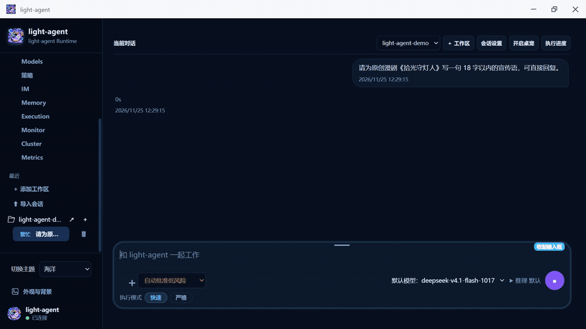
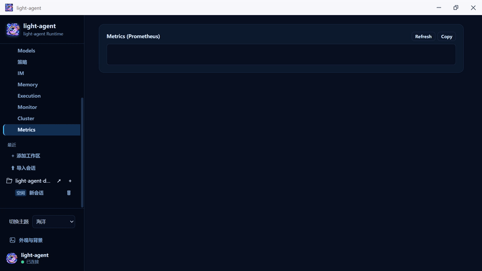
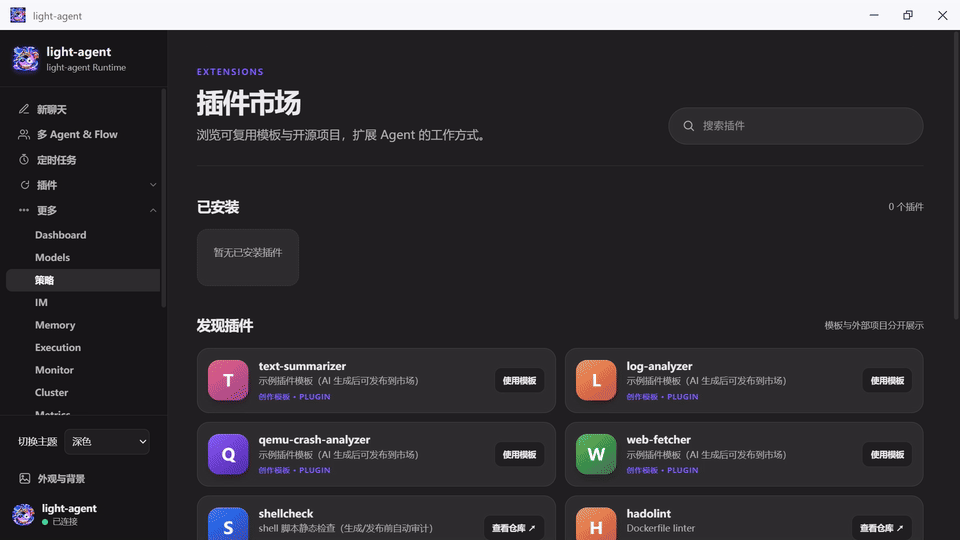
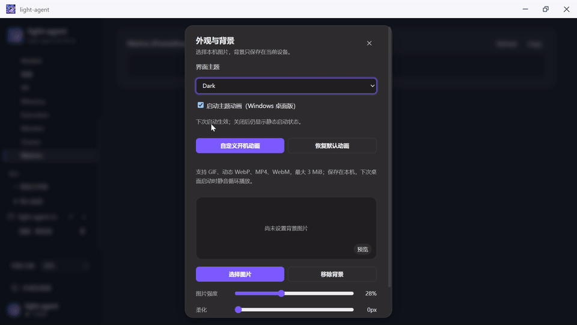
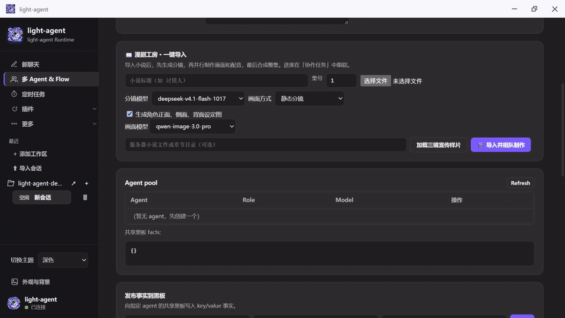
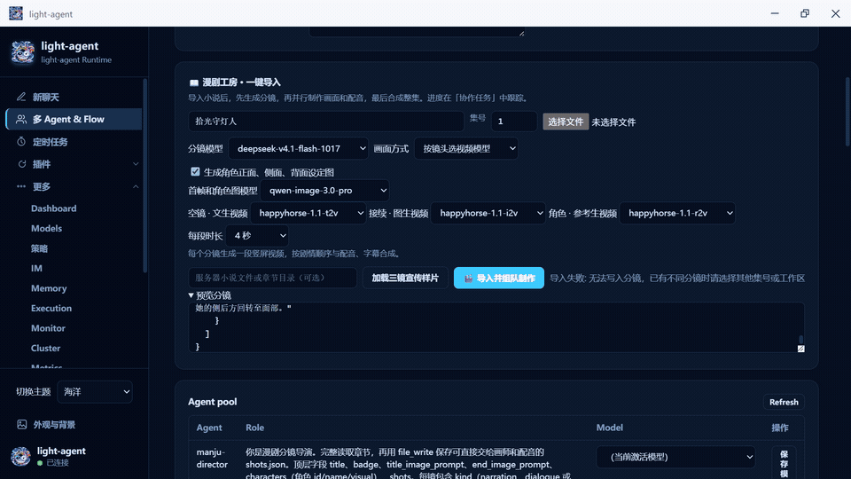
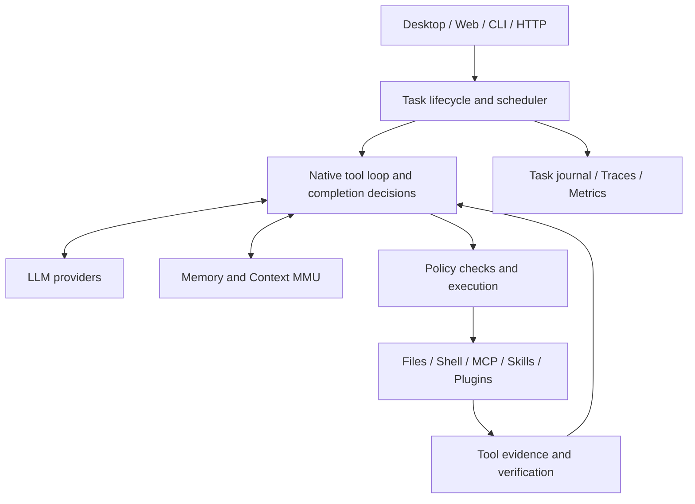

<div align="center">


# light-agent

### Give AI agents a runtime, not just a conversation.

Run tools, coordinate agents, and inspect what happened — from a C11 core with an embedded web console.

[](https://github.com/LeonQin-ai/light-agent/actions/workflows/ci.yml)
[](https://github.com/LeonQin-ai/light-agent/releases/latest)
[](#architecture)
[](#quick-start)
[](LICENSE)

**[Download](https://github.com/LeonQin-ai/light-agent/releases/latest) · [Quick start](#quick-start) · [Desktop demos](#desktop-demos) · [Developer guide](backend/README.md) · [中文](README.zh-CN.md)**

</div>

**light-agent is a local-first, model-agnostic agent runtime.** Use it as a desktop assistant, a CLI, or an HTTP service. Connect a model, give it tools, and follow tasks through model requests, commands, file changes, and final results.

The core is written in C11 and embeds its web console. Prebuilt packages do not require a Node.js or Python application stack; extensions such as browser automation and Python skills bring their own runtimes.

## Desktop demos

### 1. Animated comic showcase

These demos were produced with the light-agent comic workflow and include Chinese audio and subtitles.

#### Tidal Beacon · Three characters, one scene

When fog blocks the channel, a navigator, an engineer, and a keeper relight the beacon to guide a fishing boat home. All four shots use HappyHorse R2V with the same three reference portraits. Each character has a different voice. [Download MP4 · 16 seconds](docs/demo/tidal-beacon-motion.mp4) · [Storyboard, profiles, and reference portraits](docs/demo/tidal-beacon-project.zip)

https://github.com/user-attachments/assets/c0e9fb7d-0b85-4fae-804b-07d754cbb60a

#### The Bell Beyond the Mountain · Dragon-Slayer · Continuity cut

A-Ling fears thunder and retreats from his first encounter with the dragon. After spotting a gap in its scales, he uses the mountain wind and his grandmother's cracked bell to turn the dragon's fire. His mother's voice at the bridge brings the story back to its opening.

The revised storyboard uses four seconds per shot. The cut combines 29 original HappyHorse clips with ten new clips produced using Qwen first frames and HappyHorse. A-Ling speaks first and his mother answers off screen. The film includes 19 lines of dialogue and two locally rendered closing cards. [Download 720p MP4 · 2:44](https://github.com/LeonQin-ai/light-agent/raw/refs/heads/main/docs/demo/copper-bell-crossing.mp4) · [Revised continuity storyboard](docs/demo/copper-bell-continuity-storyboard.json)

https://github.com/user-attachments/assets/e9a5582a-8e31-45a2-bcf2-90a7ad7e91be

#### The Lighthouse Keeper

A-Cheng lights the lighthouse on a sea cliff. The three shots use text-to-video, first-frame animation, and reference-to-video. [Download MP4 · 20.4 seconds](https://github.com/LeonQin-ai/light-agent/raw/refs/heads/main/docs/demo/happyhorse-promo.mp4)

https://github.com/user-attachments/assets/5600a05c-49d3-4cf0-95be-8f0e179a9b14

#### Starlight Greenhouse

Yaya, a greenhouse robot, plants a glowing seed. The establishing shot uses text-to-video. The planting and sprouting shots share a single character turnaround sheet. [Download MP4 · 20.6 seconds](https://github.com/LeonQin-ai/light-agent/raw/refs/heads/main/docs/demo/starlight-greenhouse.mp4)

https://github.com/user-attachments/assets/8a635a60-4224-406e-9ab2-674dcd1a0ed4

### 2. Desktop chat and task progress



The Windows desktop recording shows a live DeepSeek chat, token counts, task progress, Flow, scheduled tasks, and a model test. It also shows the configuration screens for MCP, Skills, plugins, policies, chat credentials, IM, memory, snapshots, monitoring, cluster nodes, and metrics. [Full feature tour · 57 seconds](docs/demo/feature-tour.mp4)

### 3. Workspaces and conversation history



### 4. Model routing and capabilities



### 5. Themes and backgrounds



### 6. Comic production and resume

**From storyboard import to final edit**



[Uncut recording of the first run · 7 min 06 s](docs/demo/manju-desktop.mp4)

**Match the character and resume the download**



[Uncut recording of the continuity rerun · 5 min 57 s](docs/demo/manju-continuity.mp4)

**Import three characters in one batch**

The recording shows two JSON files imported together, the saved profiles and voices after reloading, and three reference images attached by character ID. [Download the walkthrough · 19 seconds](docs/demo/manju-cast-import.mp4) · [Example cast JSON](docs/demo/tidal-beacon-cast.json)

https://github.com/user-attachments/assets/49945f05-7dfe-434c-8591-669aecdd2482

## What can you build with it?

| Use case | Workflow |
|---|---|
| **Understand a codebase** | Search and read source, run commands, and produce explanations grounded in tool results. |
| **Create documents and visual reports** | Combine reasoning with installed document, Python, or shell tools; inspect the resulting files. |
| **Coordinate specialist agents** | Chain review → implementation → testing in a Flow DAG, or let role-based agents discuss a topic. |
| **Produce an animated comic** | Import fiction or a storyboard, generate shots and voice tracks with a Flow, and export an MP4. |
| **Automate recurring work** | Schedule jobs and inspect their recorded outcomes in the console. |
| **Embed an agent in your application** | Submit tasks over HTTP and read their status, tool steps, output, and metrics. |

Document generation, browser access, and multimodal tasks depend on the selected model and installed tools.

**[First-task guide](GETTING_STARTED.md) · [Contributing](CONTRIBUTING.md) · [Share the project](SHARE.md)**

## Quick start

### 1. Install or build

Download a Windows installer, Linux **x64 / ARM64 (AArch64)** portable archive, or macOS package from **[Releases](https://github.com/LeonQin-ai/light-agent/releases/latest)**. Open the desktop app, or run the server in the extracted Linux package:

```bash
./light-agent serve 18300
```

To build from source:

```bash
git clone https://github.com/LeonQin-ai/light-agent.git
cd light-agent/backend
```

| Platform | Build command | Prerequisites |
|---|---|---|
| Linux | `make` | C compiler and Make |
| macOS | `make` | Xcode Command Line Tools |
| Windows / Git Bash | `bash build.sh cli` | Git Bash; script locates or bootstraps pinned Zig |
| Windows / PowerShell | `.\build.ps1 -Target cli` | PowerShell; script locates or bootstraps pinned Zig |

From `backend`, run `./build/light-agent serve 18300` (Windows: `./build/light-agent.exe serve 18300`).

### 2. Connect a model

Open **http://localhost:18300/** and configure a route on the **Models** page: provider, base URL, model, and API key. OpenAI-compatible endpoints, Anthropic, and local model services are supported. Use the mock provider for offline development.

The desktop app also uses port `18300`; close it before starting another server on that port. Keep API keys in local configuration, outside version control.

### 3. Start with a task you can verify

Try: **“Read this repository and write a source overview to overview.md. Cite the files you inspected.”** Follow the tool trace, then open the result.

Choose execution and state directories explicitly for CLI deployments:

```bash
./build/light-agent --workspace /path/to/project --state /path/to/state serve 18300
```

**Workspace support:** The main branch includes saved workspace folders, per-chat workspace selection, and task-local execution directories. These changes are now integrated into `main`. Workspace selection chooses the execution root; it is not a security sandbox.

### Authorize credentials in strict mode

In the chat composer, select **严格 → 凭据授权** (Strict → Credential authorization). Choose an operation and destination, enter the password or API key in the password field, then insert the generated `cred_…` reference into your request. For example, choose Git HTTPS clone and ask the agent to clone the repository using that reference. Only strict-mode tasks in the issuing chat can use it. To revoke access, reopen the dialog in that chat and select **撤销授权** with the reference.

| Credential | Operation authorized by one grant |
| --- | --- |
| Git HTTPS | List remote refs or clone the specified repository into a new workspace subdirectory |
| PostgreSQL | Verify the TLS certificate and hostname, then run the read-only SELECT specified in the grant; an empty query returns the database name |
| API key | Send a Bearer GET to one HTTPS URL without following redirects |

The adapter requires Python 3 and `keyring`. Cloning also requires Git, and PostgreSQL queries require `psycopg`. Windows end-to-end tests cloned a repository over local HTTPS and verified its file contents, then queried a temporary PostgreSQL instance using TLS and SCRAM password authentication. [Setup and dependencies](backend/docs/credential-grants.md) · [End-to-end test](backend/tests/test_credential_grant_e2e.py)

## See the work as it happens
**Terminal client:** run `light-agent chat` to connect to the
desktop/server Runtime, continue durable conversations, inspect tool execution,
and cancel with Ctrl+C. Interactive terminals use a full-screen layout; native
OpenAI-compatible answers arrive incrementally as provisional previews.
Use `chat -p "your task"` for scripts. See the
[terminal client guide](backend/README.md#terminal-client).


Persistent conversations, image attachments, model selection, task steering, and execution history share one console. Tool details expose commands, results, status, and duration so you can investigate the run.


Flow DAGs express task dependencies. Group discussions let registered roles respond to other members across configurable rounds. Skills, MCP connections, and plugins extend available tools.

<details>
<summary>Explore Skills and Plugins</summary>


</details>

Screenshots use a local demonstration configuration and mock execution; they do not establish real-model task quality.

## Animated comics with HappyHorse 1.1

The desktop comic workshop uses one Flow for the storyboard, visuals, voice tracks, and final edit. In **按镜头选视频模型** (Choose video models per shot), assign one model to each kind of input.

| Model | Input | Typical shot |
|---|---|---|
| `happyhorse-1.1-t2v` | Text prompt | Establishing shots, landscapes, and effects that need no character reference |
| `happyhorse-1.1-i2v` | One first-frame image and a prompt | Preserve the opening composition or start from a supplied continuity frame |
| `happyhorse-1.1-r2v` | One to nine reference images and a prompt | Reuse visual references for a recurring character, costume, or prop across shots |

The selected image route can draw a first frame and front, side, and back character views. Reference images help preserve a character's visual identity. Review the rendered clips for continuity before reusing them. [Alibaba Cloud Token Plan video generation](https://help.aliyun.com/en/model-studio/token-plan-video-generation) · [First-frame API](https://help.aliyun.com/en/model-studio/happyhorse-image-to-video-api-reference) · [Reference-to-video API](https://help.aliyun.com/en/model-studio/happyhorse-reference-to-video-api-reference)

1. Open **更多 → Models** (More → Models) and add the three **HappyHorse** Token Plan route presets. Add an image route such as `qwen-image-3.0-pro` to generate first frames and character references. Use the **Test** button on each route to check its setup.
2. Open **多 Agent & Flow → 漫剧工房** (Multi-Agent & Flow → Comic Workshop). Import a `.txt` or `.md` chapter, import a storyboard `.json`, or select **加载三镜宣传样片** (Load three-shot promo). The built-in storyboard establishes a lighthouse with T2V and follows the same original lighthouse keeper, A-Cheng, in its I2V and R2V shots.
3. To reuse existing character art, open **导入参考人物图** (Import character references), enter the character's name as it appears in the script, and add PNG, JPEG, or WebP images. In **按镜头选视频模型** (Choose video models per shot), reference-to-video shots use the matching images for each named character in the shot.
4. To produce several episodes in one run, select multiple chapter files, a single `.txt` or `.md` with `第…集` or `第…章` headings, multiple storyboard `.json` files, or a single JSON array of storyboards. Set **制作范围** (Production scope) to **全部章节** (All chapters) or **指定范围** (Episode range), then select **导入并组队制作** (Import and produce). The batch shares character references across episodes, while automatic storyboarding carries forward the previous episode's ending.
5. Use **查看制作进度** (View production progress) to follow each episode, then open `manju/epNN/videos/epNN-motion.mp4` in the workspace. Completed clips are reused when a run resumes. Audio and assembly require local Python and the comic pipeline dependencies. Custom storyboards support `text`, `first_frame`, and `reference` in `video_mode`. Each clip can run for three or four seconds.

The **文生视频** (Text-to-video) option also supports single-route production with Alibaba Cloud Kling or Volcano Engine Seedance.

Novel imports default to **角色对白** (Character dialogue). Storyboards specify spoken lines, on-screen action, and scene backgrounds. Shots without lines can use ambience and cues such as wind, fire, footsteps, or a bell. The video flow checks that each line fits its three- or four-second shot before requesting video. Imported storyboards default to their authored audio mode.

For dialogue novels, the production team processes story structure, shot design, art direction, and sound in order. The controller compiles a nine-part director brief in `shots.json`, and the workshop shows the current stage. Authored storyboards can go straight to production, with text cards rendered by the editor. [Copyable prompts and an API example](backend/docs/manju-director-agents.md)

Use **角色档案 → 批量导入角色** (Character profiles → Batch import) to select one or more UTF-8 JSON files. One import can save multiple characters and their voice settings in the current workspace. Download the example JSON from the import form. If a character ID already exists, the import leaves the roster unchanged unless you select **更新同 ID 角色** (Update matching IDs). Subsequent episodes can reuse the same profiles and voices. Attach reference images by character ID in **参考人物图** (Character references).

The Windows desktop app completed the first Lighthouse Keeper run in 4 min 45 s with all three configured HappyHorse models. The sample uses a prepared storyboard and a character reference sheet generated by `qwen-image-3.0-pro`. The continuity rerun started from a selected first frame and made one new generation request. After a download interruption, the app resumed using the existing provider task ID. The final video is 720 × 1280. [Finished comic and recordings](#desktop-demos)

## Architecture



| Runtime service | What it provides |
|---|---|
| **Task lifecycle** | Scheduling, cancellation, durable state, and explicit recovery. |
| **Native tool loop** | Structured `tool_calls` / `tool_use` and completion declarations rather than answer-keyword matching. |
| **Memory and context** | Memory lifecycle services, budgeted hot/warm/cold context tiers, and [viewable memory summaries](backend/docs/memory-summary.md) generated on demand. |
| **Execution and policy** | Action checks, file snapshots, verification, and rollback for supported operations. |
| **Coordination** | Role registration, dependency-based Flows, and group discussions. |
| **Observability** | Model/tool milestones, token accounting where available, task records, and metrics. |

File rollback does not undo arbitrary network or shell side effects. Workspace selection is not process isolation; recovery does not guarantee exactly-once execution. Distributed scheduling and enterprise multi-tenancy remain roadmap work. See the [implementation status](backend/docs/LIGHT_AGENT_DETAILED_DESIGN_V3.1.md).

## Evidence, not just feature claims

These are **historical project-reported runs**, not a fresh evaluation of every release. Models, tools, sample size, and run variance affect results.

| Evaluation | Recorded result | Scope |
|---|---|---|
| GAIA 2023 validation | **78.79%** | 165 tasks; GLM-5.3-flash; 2026-09-11 |
| SWE-bench Verified mini | **8/11** | 11-task sample; GLM-5.3-flash; 2026-09-12 |
| BFCL-style function calling | **20–22/22** | Project-built cases; deepseek-chat |
| WebArena-style browser tasks | **6/6** | Small project-built suite; GLM-5.3-flash |

The SWE-bench report also records a Docker-isolated rerun at **5/11**. Mini and “style” suites are not full official benchmark results. Read the [scorecard](backend/docs/BENCHMARK_RESULTS.md) and [methodology](backend/docs/benchmark-report.md) before comparing systems.

On the documented Windows machine, a deterministic workload completed **1,000,000 tasks in 65.972 seconds**, with 100 registered roles, 8 workers, and **78.65 MiB sampled peak RSS** (three-run median duration). This measures scheduling and context probes, **not one million LLM requests**. Registered roles are not concurrent processes.


[Setup and limits](backend/docs/runtime-benchmark-expanded.md) · [Raw million-task data](backend/docs/runtime-million-2026-10-14.json) · [Memory and queue samples](backend/docs/runtime-memory-2026-10-14.svg)

Real-model regressions, including failures and API costs, remain in the [historical report](https://github.com/LeonQin-ai/light-agent/blob/v1.0.0/backend/docs/token-regression-report.md). They are targeted checks, not universal completion or token-efficiency guarantees.

## Build on the HTTP API

```bash
# Submit a task; the response contains its ID.
curl -X POST http://localhost:18300/v1/chat \
  -H 'Content-Type: application/json' \
  -d '{"message":"Create note.txt containing hello"}'

# Replace 0 with the returned task ID.
curl http://localhost:18300/v1/tasks/0
curl http://localhost:18300/v1/tasks/journal
curl http://localhost:18300/metrics
```

Authentication, model configuration, local Skills, MCP, and API details: **[developer guide](backend/README.md)**.

## Test and contribute

CI covers Windows, Linux, Linux AddressSanitizer, macOS Apple Silicon, and macOS Intel. Check the [workflow](https://github.com/LeonQin-ai/light-agent/actions/workflows/ci.yml) for a commit’s actual status.

```bash
cd backend
COA_TOOL_PROTOCOL=legacy make test
COA_TOOL_PROTOCOL=legacy make scenario
```

On Windows, run `bash build.sh test`, then `./build/light-agent-test.exe`. Offline fixtures validate runtime behavior without paid model calls. Live-model evaluations require credentials; browser tests need Playwright. Exact commands and environment settings are in [CI](.github/workflows/ci.yml) and the [developer guide](backend/README.md).

We welcome **reproducible task failures, provider compatibility fixes, tool recovery, context efficiency, UI accessibility, and documentation**. Include version/commit, OS, model/provider, expected behavior, and a redacted trace in bug reports. Never attach API keys or unauthorized private source.

**[Report a bug](https://github.com/LeonQin-ai/light-agent/issues/new) · [Find an issue to work on](https://github.com/LeonQin-ai/light-agent/issues)**

## Go deeper

| Resource | Contents |
|---|---|
| [Developer guide](backend/README.md) | Build, configuration, APIs, extensions, and local models |
| [Architecture baseline](backend/docs/LIGHT_AGENT_ARCHITECTURE_BASELINE_V3.0.md) | Component boundaries and design direction |
| [Detailed design](backend/docs/LIGHT_AGENT_DETAILED_DESIGN_V3.1.md) | Implementation status and remaining work |
| [Runtime whitepaper](backend/docs/runtime-whitepaper.md) | Scheduling, memory, execution, and diagrams |
| [Secret-security design](backend/docs/LIGHT_AGENT_SECRET_SECURITY_DDD_V1.0.md) | Security model and acceptance criteria |
| [Technical blog](https://leonqin-ai.github.io/) | Eight Chinese engineering articles linked to source and evidence |
| [Five-minute console recording](backend/docs/runtime-demo.mp4) | Real runtime/tool execution with a deterministic local model fixture |

## License

**[Apache License 2.0](LICENSE)**. Attribution and retained notices: [NOTICE](NOTICE). Third-party components keep their licenses. Earlier MIT-licensed releases remain available under their original terms.
