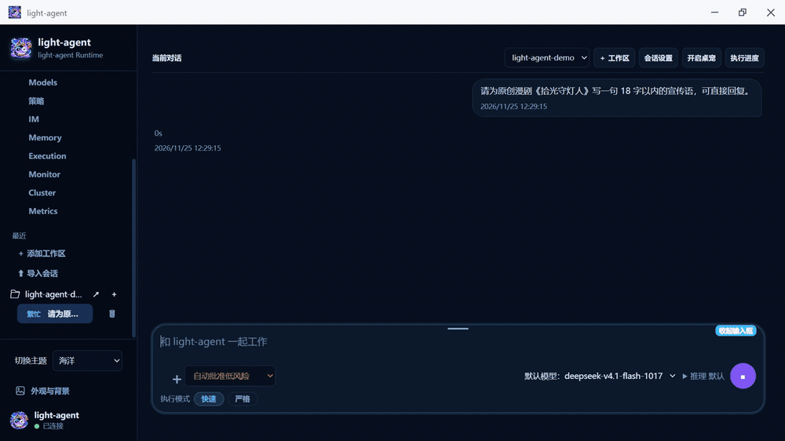
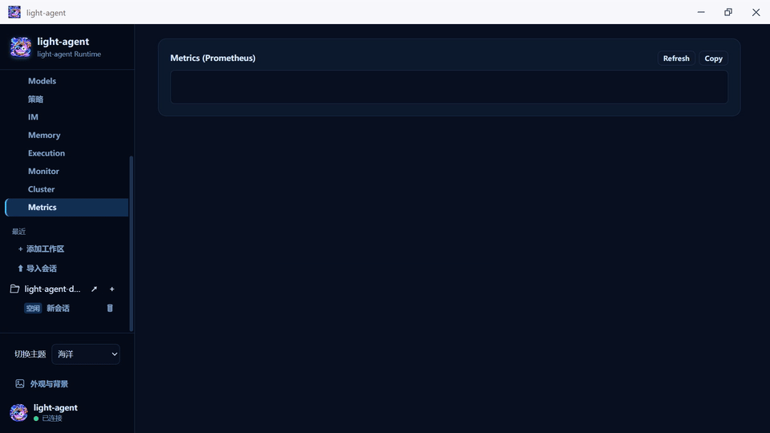
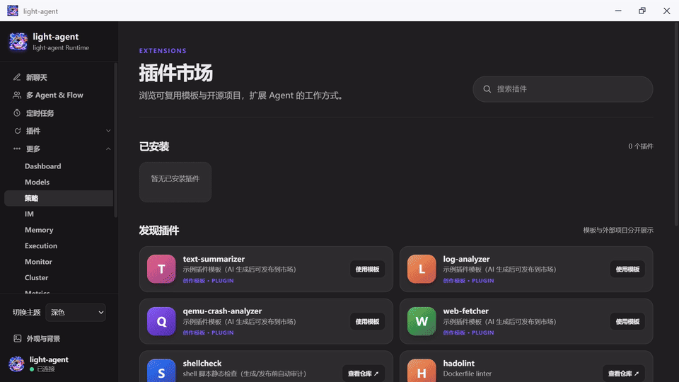
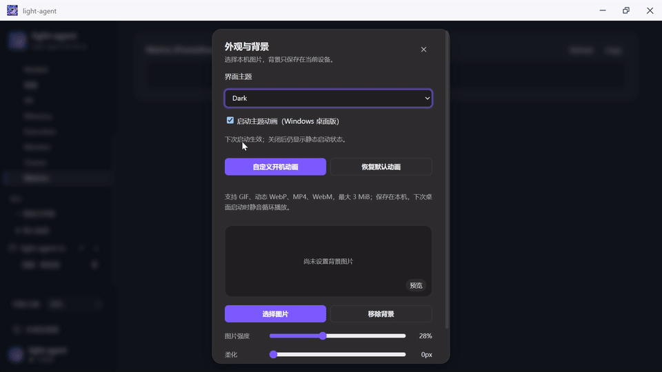
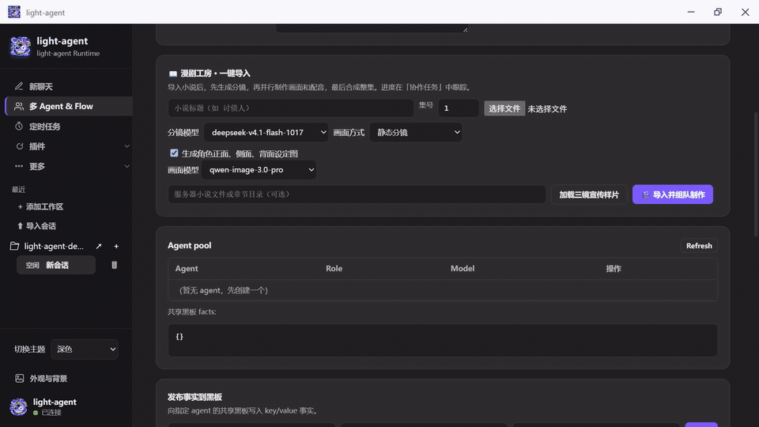
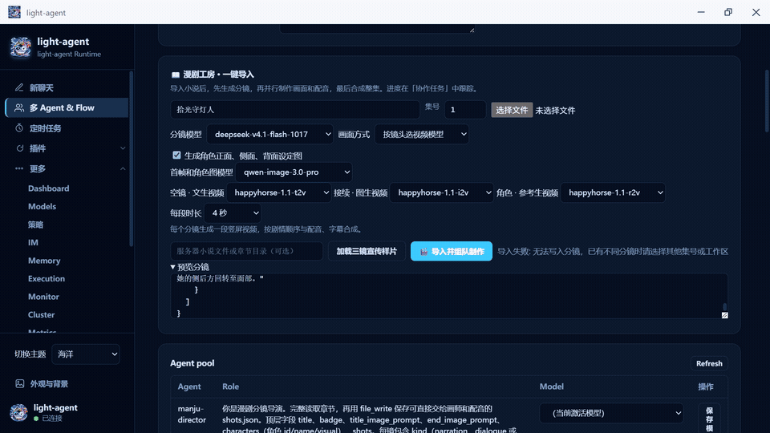
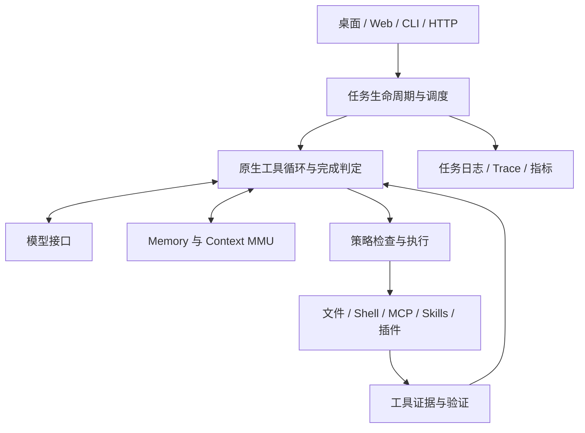

<div align="center">


# light-agent

### 让 AI 从回答问题，走向执行任务。

用 C11 构建智能体运行时，把工具执行、多 Agent 协作与过程追踪放进一个本地应用。

[](https://github.com/LeonQin-ai/light-agent/actions/workflows/ci.yml)
[](https://github.com/LeonQin-ai/light-agent/releases/latest)
[](#架构与设计)
[](#快速开始)
[](LICENSE)

**[下载体验](https://github.com/LeonQin-ai/light-agent/releases/latest) · [快速开始](#快速开始) · [桌面端演示](#桌面端演示) · [开发文档](backend/README.md) · [English](README.md)**

</div>

**light-agent 是一个本地优先、模型无关的智能体运行时。** 你可以把它作为桌面助手、命令行工具，或通过 HTTP 接入自己的应用。连接模型、赋予工具，再从记录中查看它调用了什么、修改了什么、最终交付了什么。

核心采用 C11，应用内嵌 Web 控制台。预编译版本无需先搭建 Node.js 或 Python 应用环境；浏览器自动化、Python 技能等扩展则需要各自的运行环境。

## 桌面端演示

### 1. 漫剧作品展示

以下作品由 light-agent 漫剧流程生成，带有中文配音和字幕。

#### 《铜铃过山》· 少年屠龙

怕雷的少年阿铃带着祖母留下的缺口铜铃上山。第一次交手败北后，他再次走进石峡，迎战威胁村庄的恶龙。

剧本由 light-agent 中的 DeepSeek 创作。漫剧工房以 Qwen 分镜图为首帧，用 HappyHorse 生成 43 段 4 秒视频，其中 10 处通过慢镜和补帧衔接。成片保留原来的中文配音和按时间轴对齐的字幕。 [下载 720p MP4 · 3:32](https://github.com/LeonQin-ai/light-agent/raw/refs/heads/main/docs/demo/copper-bell-crossing.mp4) · [原始故事分镜](docs/demo/copper-bell-storyboard.json)

https://github.com/user-attachments/assets/1529e5c8-7910-416b-a8f5-fa1e8aa3bb48

#### 《拾光守灯人》

守灯人阿澄点亮海崖灯塔。三个镜头分别使用文生视频、首帧生视频和参考生视频。[下载 MP4 · 20.4 秒](https://github.com/LeonQin-ai/light-agent/raw/refs/heads/main/docs/demo/happyhorse-promo.mp4)

https://github.com/user-attachments/assets/5600a05c-49d3-4cf0-95be-8f0e179a9b14

#### 《星光温室》

园艺机器人芽芽种下一颗发光的种子。屋顶空镜由文生视频生成，播种和发芽两镜共用一套角色三视图。[下载 MP4 · 20.6 秒](https://github.com/LeonQin-ai/light-agent/raw/refs/heads/main/docs/demo/starlight-greenhouse.mp4)

https://github.com/user-attachments/assets/8a635a60-4224-406e-9ab2-674dcd1a0ed4

### 2. 桌面对话与执行进度



动画来自 Windows 桌面端实录。全片展示 DeepSeek 真实对话、Token 统计、任务进度、Flow、定时任务、模型测试，以及 MCP、Skills、插件、策略、会话凭据、IM、记忆、快照、监控、集群和指标的配置入口。[完整功能演示 · 57 秒](docs/demo/feature-tour.mp4)

### 3. 工作区与历史会话



### 4. 模型路由与能力标签



### 5. 主题与背景



### 6. 漫剧制作与断点恢复

**从导入分镜到剪辑合成**



[首次制作全程录像 · 7 分 06 秒](docs/demo/manju-desktop.mp4)

**锁定主角首帧并恢复下载**



[主角衔接补跑全程录像 · 5 分 57 秒](docs/demo/manju-continuity.mp4)

## 你可以用它做什么？

| 场景 | 工作方式 |
|---|---|
| **理解一个代码仓库** | 搜索源码、分段阅读、运行命令，输出有文件依据的分析。 |
| **制作文档与可视化报告** | 配合已安装的文档、Python 或 shell 工具生成文件，并检查实际产物。 |
| **组织多个专业 Agent** | 用 Flow DAG 串联审核、实现、测试，或让不同角色围绕同一话题相互讨论。 |
| **制作动态漫剧** | 导入小说或分镜，用 Flow 生成镜头和配音，剪辑后导出 MP4。 |
| **处理周期性工作** | 设置定时任务，在同一控制台查看执行结果。 |
| **为自己的应用加入 Agent** | 通过 HTTP 提交任务，读取状态、工具步骤、输出和指标。 |

文档生成、浏览器操作和多模态任务取决于所选模型及已安装工具。

**[首次任务指南](GETTING_STARTED.md) · [贡献指南](CONTRIBUTING.md) · [项目分享素材](SHARE.md)**

## 快速开始

### 1. 下载或构建

从 **[Releases](https://github.com/LeonQin-ai/light-agent/releases/latest)** 下载 Windows 安装包、Linux 便携包或 macOS 应用包。打开桌面应用；Linux 便携包解压后可运行：

```bash
./light-agent serve 18300
```

希望从源码构建？

```bash
git clone https://github.com/LeonQin-ai/light-agent.git
cd light-agent/backend
```

| 平台 | 构建命令 | 环境要求 |
|---|---|---|
| Linux | `make` | C 编译器和 Make |
| macOS | `make` | Xcode Command Line Tools |
| Windows / Git Bash | `bash build.sh cli` | Git Bash；脚本定位或引导安装固定版本 Zig |
| Windows / PowerShell | `.\build.ps1 -Target cli` | PowerShell；脚本定位或引导安装固定版本 Zig |

在 `backend` 目录执行 `./build/light-agent serve 18300`；Windows 执行 `./build/light-agent.exe serve 18300`。

### 2. 连接模型

打开 **http://localhost:18300/**，在 **Models** 页面配置 provider、base URL、模型名称和 API key。支持 OpenAI 兼容接口、Anthropic 与本地模型服务；离线开发可使用 mock provider。

桌面应用同样使用 `18300` 端口，另起服务前请先关闭桌面应用。API key 留在本地配置中，不要提交到仓库。

### 3. 从一个可验证的任务开始

试试：**“阅读这个仓库，将源码概要写入 overview.md，并标明你实际阅读的文件。”** 查看工具记录，再打开文件核对结果。

CLI 部署可以显式指定执行目录和状态存储位置：

```bash
./build/light-agent --workspace /path/to/project --state /path/to/state serve 18300
```

**工作区支持：** 主干已集成工作区文件夹、会话工作区选择和任务独立执行目录，已合并到 `main`。工作区选择决定执行根目录，不等同于安全沙箱。

### 在严格模式下授权凭据

在聊天输入框选择 **严格 → 凭据授权**，选定操作和目标地址，在密码框输入密码或 API Key，再点 **授权并插入引用**。例如，选择 Git HTTPS 克隆后，可以发送「用这个引用克隆仓库」，并保留插入的 `cred_…`。聊天中只需要引用。引用仅供当前会话的严格模式任务使用，快速模式无法使用它。要撤销授权，在同一会话重新打开授权框，粘贴引用并选择 **撤销授权**。

| 类型 | 每次授权允许的操作 |
| --- | --- |
| Git HTTPS | 查看指定仓库的远端引用，或将它克隆到工作区的新子目录 |
| PostgreSQL | 校验证书和主机名后执行授权时填写的只读 SELECT；留空则查询当前数据库名 |
| API Key | 对一个指定的 HTTPS 地址发送 Bearer GET，不跟随重定向 |

运行环境需要 Python 3 和 `keyring`；克隆需要 Git，PostgreSQL 查询另需 `psycopg`。Windows 端到端测试通过本地 HTTPS 服务实际克隆了仓库并读回文件，也通过 TLS 和 SCRAM 密码认证查询了临时 PostgreSQL 实例。[依赖与配置](backend/docs/credential-grants.md) · [端到端测试](backend/tests/test_credential_grant_e2e.py)

## 看见任务是怎么完成的
**终端客户端：** 执行 `light-agent chat` 连接桌面端或服务端 Runtime，
继续持久化会话、查看工具执行，用 Ctrl+C 请求取消。脚本调用可用 `chat -p "你的任务"`。
交互式终端采用全屏布局；OpenAI 兼容原生工具协议的答复支持增量预览，仍需通过完成验证。
详见[终端客户端指南](backend/README.md#terminal-client)。


控制台集中展示持久化会话、图片附件、模型选择、执行中补充要求与任务历史。工具详情包含命令、结果、状态和耗时，便于从实际记录中排查问题。


多 Agent Flow 用 DAG 表达任务依赖；群聊让注册角色在可配置的轮次内阅读并回应其他成员。Skills、MCP 和插件提供扩展入口。

<details>
<summary>展开查看 Skills 与插件管理界面</summary>


</details>

截图使用本地演示配置与 mock 执行，不作为真实模型任务能力的证明。

## 用 HappyHorse 1.1 制作漫剧

桌面端「漫剧工房」用同一个 Flow 管理分镜、画面、配音和剪辑。「按镜头选视频模型」可以在同一集里按输入素材选择三种路由。

| 模型 | 输入 | 适合的镜头 |
|---|---|---|
| `happyhorse-1.1-t2v` | 文本提示词 | 场景空镜、远景和无需固定角色的特效 |
| `happyhorse-1.1-i2v` | 1 张首帧图与提示词 | 控制开场构图，或用提供的衔接画面作为起点 |
| `happyhorse-1.1-r2v` | 1～9 张参考图与提示词 | 跨镜头复用人物、服装和道具的参考素材 |

文生图路由可生成分镜首帧和角色正面、侧面、背面设定图。参考素材有助于保留角色外观，成片可逐镜核对人物一致性。[阿里云 Token Plan 视频接入](https://help.aliyun.com/en/model-studio/token-plan-video-generation) · [首帧生成 API](https://help.aliyun.com/en/model-studio/happyhorse-image-to-video-api-reference) · [参考生成 API](https://help.aliyun.com/en/model-studio/happyhorse-reference-to-video-api-reference)

1. 在 **更多 → Models** 分别添加三个 **HappyHorse（百炼 Token Plan）** 预设。需要生成首帧及角色参考图时，添加 `qwen-image-3.0-pro` 等文生图路由。点击各路由条目的 **Test** 检查配置。
2. 打开 **多 Agent & Flow → 漫剧工房**。导入 `.txt` 或 `.md` 章节、导入分镜 `.json`，或点击 **加载三镜宣传样片**。内置《拾光守灯人》用 T2V 展示灯塔空镜，后两镜分别用 I2V 和 R2V 演出同一位原创守灯人阿澄。
3. 如果已有角色设定图，打开 **导入参考人物图**，输入剧本里的角色名并添加 PNG、JPEG 或 WebP。选择 **按镜头选视频模型**，参考生视频镜头会按角色使用对应图片，同框镜头可以带上多位角色的参考图。
4. 一次导入多集时，可选择多个章节文件、带 `第…集` 或 `第…章` 标题的 `.txt` 或 `.md` 文件，或多个分镜 `.json` 文件（也可使用单个 JSON 数组）。在 **制作范围** 选择 **全部章节** 或 **指定范围**，再点击 **导入并组队制作**。同批各集复用角色参考图，自动生成分镜时会承接上一集结尾。
5. 从 **查看制作进度** 跟踪各集，完成后在工作区打开 `manju/epNN/videos/epNN-motion.mp4`。继续任务时会复用已保存的片段。配音与合成需要本机 Python 和漫剧依赖。自定义分镜的 `video_mode` 支持 `text`、`first_frame` 和 `reference`，每段可选 3 秒或 4 秒。

「文生视频」模式还可以选择百炼可灵或火山方舟 Seedance，以单路由制作整集。

《拾光守灯人》在 Windows 桌面端用三个已配置的 HappyHorse 模型完成首次制作，用时 4 分 45 秒。样片采用预写分镜和 `qwen-image-3.0-pro` 生成的 R2V 角色参考图。第二镜锁定首帧后只新增了 1 次视频生成请求，下载中断时沿用原任务 ID 恢复。成片分辨率为 720 × 1280。[成片与实录](#桌面端演示)

## 架构与设计



| 运行时服务 | 提供的能力 |
|---|---|
| **任务生命周期** | 调度、取消、状态记录，以及中断任务的显式恢复。 |
| **原生工具循环** | 使用结构化 `tool_calls` / `tool_use` 和完成声明，不用答复关键词猜测是否继续。 |
| **记忆与上下文** | 记忆生命周期服务，以及带预算的 hot/warm/cold 上下文分层。 |
| **执行与策略** | 动作检查、文件快照、验证，以及支持范围内的回滚。 |
| **多 Agent 协作** | 角色注册、Flow 依赖执行和群组讨论。 |
| **可观测性** | 模型与工具阶段、可获得的 token 统计、持久化任务记录和指标。 |

文件回滚不能撤销任意网络或 shell 副作用；工作区选择不是进程隔离；恢复不保证 exactly-once 执行。分布式调度和企业多租户仍属后续方向。实现状态与缺口见[详细设计](backend/docs/LIGHT_AGENT_DETAILED_DESIGN_V3.1.md)。

## 用证据说明能力

以下是**项目历史运行记录**，不是每个新版本重新评测的成绩。模型、工具、样本数量与运行波动都会影响结果。

| 评测 | 记录结果 | 范围 |
|---|---|---|
| GAIA 2023 validation | **78.79%** | 165 题；GLM-5.3-flash；2026-09-11 |
| SWE-bench Verified mini | **8/11** | 11 题样本；GLM-5.3-flash；2026-09-12 |
| BFCL 风格函数调用 | **20–22/22** | 项目自建用例；deepseek-chat |
| WebArena 风格浏览器任务 | **6/6** | 小规模自建用例；GLM-5.3-flash |

SWE-bench 报告也记录了 Docker 隔离重跑 **5/11**。mini 与“风格”用例不代表完整官方基准成绩。比较前请阅读[成绩表](backend/docs/BENCHMARK_RESULTS.md)与[方法说明](backend/docs/benchmark-report.md)。

在报告所列 Windows 测试机上，本地确定性负载以 100 个注册角色、8 个 Worker 完成 **100 万个任务，耗时 65.972 秒，采样峰值 RSS 78.65 MiB**（耗时取三轮中位数）。这是调度与上下文读取负载，**不是百万次 LLM 请求**；注册角色数量也不是并发进程数量。


[测试条件与限制](backend/docs/runtime-benchmark-expanded.md) · [百万任务原始数据](backend/docs/runtime-million-2026-10-14.json) · [内存与队列采样](backend/docs/runtime-memory-2026-10-14.svg)

真实模型回归的失败尝试和 API 成本保留在[历史回归报告](https://github.com/LeonQin-ai/light-agent/blob/v1.0.0/backend/docs/token-regression-report.md)。它们是定向验证，不代表所有任务都能完成或具有同样的 token 效率。

## 通过 HTTP 接入

```bash
# 提交任务，响应中包含任务 ID。
curl -X POST http://localhost:18300/v1/chat \
  -H 'Content-Type: application/json' \
  -d '{"message":"Create note.txt containing hello"}'

# 将 0 替换为返回的任务 ID。
curl http://localhost:18300/v1/tasks/0
curl http://localhost:18300/v1/tasks/journal
curl http://localhost:18300/metrics
```

认证、模型配置、本地 Skills、MCP 与完整 API 使用方式见 **[开发指南](backend/README.md)**。

## 测试与参与贡献

CI 覆盖 Windows、Linux、Linux AddressSanitizer、macOS Apple Silicon 和 macOS Intel。具体提交是否通过，请查看[当前工作流](https://github.com/LeonQin-ai/light-agent/actions/workflows/ci.yml)。

```bash
cd backend
COA_TOOL_PROTOCOL=legacy make test
COA_TOOL_PROTOCOL=legacy make scenario
```

Windows 可用 `bash build.sh test` 构建单元测试，再执行 `./build/light-agent-test.exe`。离线 fixture 验证运行时行为，无需付费模型调用；真实模型评测另行执行，需要 API 凭据。浏览器用例还需要 Playwright。完整命令和环境配置见 [CI](.github/workflows/ci.yml) 与[开发指南](backend/README.md)。

欢迎贡献**可复现的任务失败、模型适配、工具恢复、上下文效率、界面可访问性和文档改进**。提交问题时请附版本或 commit、操作系统、模型与 provider、预期结果，以及脱敏后的执行记录，不要上传 API key 或未获授权的私有源码。

**[反馈 Bug](https://github.com/LeonQin-ai/light-agent/issues/new) · [寻找可参与的问题](https://github.com/LeonQin-ai/light-agent/issues)**

## 深入了解

| 资料 | 内容 |
|---|---|
| [开发指南](backend/README.md) | 构建、配置、工具、API 和本地模型 |
| [架构基线](backend/docs/LIGHT_AGENT_ARCHITECTURE_BASELINE_V3.0.md) | 模块边界与设计方向 |
| [详细设计](backend/docs/LIGHT_AGENT_DETAILED_DESIGN_V3.1.md) | 实现状态与待完成工作 |
| [Runtime 白皮书](backend/docs/runtime-whitepaper.md) | 调度、内存、执行与架构图 |
| [密钥安全设计](backend/docs/LIGHT_AGENT_SECRET_SECURITY_DDD_V1.0.md) | 安全模型与验收标准 |
| [技术博客](https://leonqin-ai.github.io/) | 8 篇关联源码与验证证据的工程文章 |
| [5 分钟控制台录像](backend/docs/runtime-demo.mp4) | 确定性本地模型驱动的真实运行时与工具执行 |

## 许可证

采用 **[Apache License 2.0](LICENSE)**。归属与保留声明见 [NOTICE](NOTICE)，第三方组件保留各自许可证。早期 MIT 版本仍按原许可证提供。
